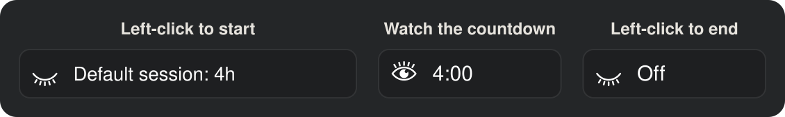
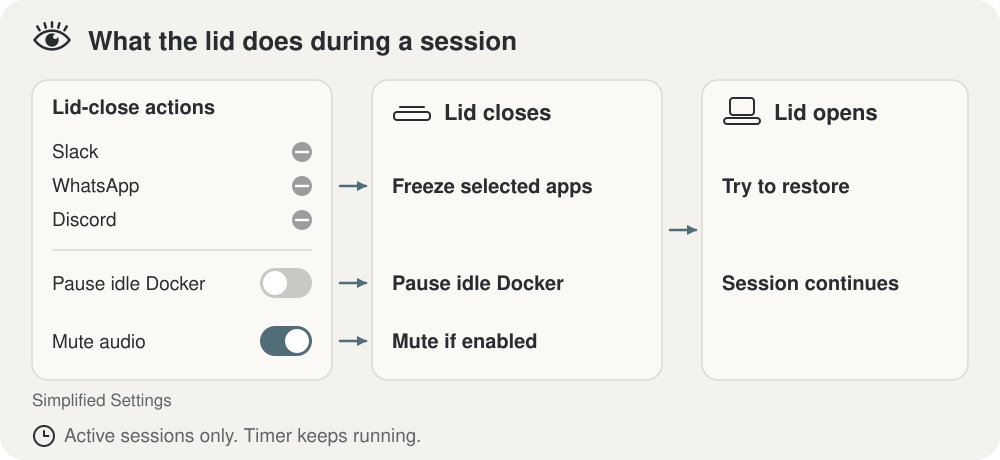
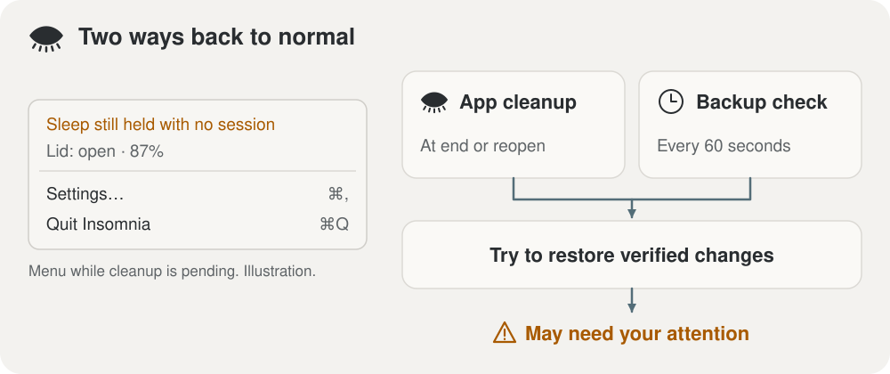

<p align="center">
  
</p>

<h1 align="center">Insomnia</h1>

<p align="center">
  <strong>Keep your Mac awake. Give the session an end time.</strong>
</p>

<p align="center">
  A macOS menu bar app for timed awake sessions. Insomnia is an eye icon that
  lives in your MacBook menu bar. It has no Dock icon and no main window. Set
  how long your Mac stays awake, choose what happens when the lid closes, and
  see when something could not be undone.
</p>

<p align="center">
  <a href="https://getinsomnia.app"><strong>Website</strong></a> ·
  <a href="#install"><strong>Install</strong></a> ·
  <a href="#using-it"><strong>Using it</strong></a> ·
  <a href="#what-happens-when-the-lid-closes"><strong>Lid close</strong></a> ·
  <a href="#how-recovery-works"><strong>Recovery</strong></a> ·
  <a href="SECURITY.md"><strong>Security</strong></a>
</p>

<p align="center">
  <a href="LICENSE"></a>
  
  
</p>

> **Use a stable, well-ventilated surface, not a closed bag.** Insomnia is
> experimental. Recovery can fail, and a running timer is not a safety
> guarantee.
> [Validation status](docs/release-validation.md) · [Apple's ventilation guidance](https://support.apple.com/en-us/102336)

<p align="center">
  
</p>

## Install

Requires macOS 26 or later on an Apple Silicon Mac.

Paste this into your coding agent:

```text
Install the latest stable Insomnia release by following https://github.com/krishhgg/Insomnia/blob/main/skills/install-insomnia/SKILL.md. If a step needs my password, give me the command to run in Terminal.
```

For the newest nightly, write "the newest Insomnia nightly prerelease" in
place of "the latest stable Insomnia release". Nightlies are built from `main`
on each day it has new commits. They have the newest code and may be broken.

To install a release yourself, follow [docs/install.md](docs/install.md). It
covers both channels, how to check the download, and `v0.1.0`, which installs
differently. Settings > App shows the installed version, and "Check for
updates" there tells you whether a newer release exists without installing
anything.

### Build from source

Needs Xcode with Swift 6.2 or later. Replace `v<version>` with the latest
stable tag, or a nightly tag for the newest code:

```bash
git clone --branch v<version> --depth 1 https://github.com/krishhgg/Insomnia.git
cd Insomnia
./scripts/install.sh
open "$HOME/Applications/Insomnia.app"
```

<details>
<summary><strong>What the installer changes on your Mac</strong></summary>

The installer needs your password, because the sudoers rule is a system
file. It installs:

- The app, at `~/Applications/Insomnia.app`.
- A **recovery agent**, a `launchd` job that runs every minute. If the app is
  gone when a session should have ended, the agent tries to undo the
  session's changes.
- A **sudoers rule** at `/etc/sudoers.d/insomnia`. A sudoers rule decides who
  can run what with `sudo`. This one lets your user account, not just
  Insomnia, run these four commands without a password:

```text
/usr/bin/pmset -a disablesleep 1
/usr/bin/pmset -a disablesleep 0
/usr/bin/pmset -b lowpowermode 1
/usr/bin/pmset -b lowpowermode 0
```

Any program running as you can use that rule too, so review it before you
install. [docs/install.md](docs/install.md#what-gets-installed) lists every
file and explains how upgrades replace them.

</details>

## Using it

1. **Start.** Click the eye in the menu bar, enter days, hours and minutes,
   and press Enter.
2. **Add time.** Click the eye or the countdown during a session.
3. **End early.** Press and hold the end control next to the countdown.
4. **Settings and status.** Right-click the eye. Quit asks Insomnia to undo
   the session first, and it refuses while a change is still waiting to be
   undone. Saved audio for an output that isn't connected doesn't hold it up.
   Insomnia restores that output if it reconnects while the app runs, or at
   the next launch.
5. **From a script or an agent.** The app's binary drives the running app:

   ```bash
   INSOMNIA=~/Applications/Insomnia.app/Contents/MacOS/Insomnia
   "$INSOMNIA" --session start 7200    # two hours
   "$INSOMNIA" --session extend 1800
   "$INSOMNIA" --session status
   "$INSOMNIA" --session end
   ```

   It starts, extends and ends the same session the menu bar counts down,
   with the same battery and heat rules, and prints one line. It changes
   nothing itself, so when the app isn't running it says so and exits 1.
   A build without this mode opens the menu bar app instead, so a script
   that may meet one checks `InsomniaSessionCommandVersion` in the bundle's
   `Info.plist` first.

You don't have to close the lid, and opening it doesn't end the session.

On battery power, Insomnia turns on Low Power Mode below 40% and ends the
session below 10%. Those are the defaults. You can change both in Settings,
and an end floor of 0 turns the battery end off. The heat rules turn on Low Power
Mode when the Mac gets seriously hot and end the session at critical heat.
They are on by default, and Settings can turn them off. All of these rules
only work while the app runs.

Before your first session, check Settings. Then run a short session you can
watch, and read `~/Library/Logs/Insomnia/insomnia.log` afterward.

## What happens when the lid closes

<p align="center">
  
</p>

During a session, closing the lid does each of these, and opening it tries
to undo them. The timer keeps counting down while the lid is closed.

- **Display and keyboard light go off.** Insomnia saves their brightness
  first. With sleep turned off, macOS no longer does this by itself.
- **Apps on the freeze list are frozen.** Freezing sends an app's processes
  `SIGSTOP`, which pauses them until `SIGCONT` on lid open. The list starts
  with Slack, WhatsApp and Discord. "Freeze every other app" is off by
  default. Even when on, it skips meeting, recording and dictation apps: Zoom,
  Teams, Webex, FaceTime, Wispr Flow, Granola, Otter, OBS and Loom.
- **Audio is muted.** Lid open unmutes each output Insomnia muted, even if you
  switched to another one.
- **Low Power Mode turns on.** It turns off when the lid opens, unless a
  battery or heat rule still needs it.
- **Docker Desktop is frozen when no container runs.** This one is off by
  default.

On Mac laptops with Apple silicon or a T2 chip, closing the lid disconnects
the built-in microphone in hardware. Recording a meeting with the lid closed
needs AirPods or an external mic.

[docs/lid-close.md](docs/lid-close.md) has the details: how Docker is checked,
how brightness is restored, the one-time settings change when you upgrade,
and how to test lid actions without closing the lid.

## How recovery works

<p align="center">
  
</p>

Insomnia writes each change to a **recovery journal**, a file on disk, before
it makes the change. Ending the session tries to undo what the journal lists.
If the app crashes or quits, the recovery agent tries the same once the
session's end time has passed.

Some things need you:

- The recovery agent can't restore audio. Open Insomnia again for that.
- The recovery agent doesn't watch the battery or the temperature.
- Insomnia only unfreezes a process it can prove it froze. A frozen process
  it can't prove stays frozen until you check it.

If the menu shows a recovery warning, deal with it before you leave the Mac
alone. [docs/recovery.md](docs/recovery.md) explains each case.

## Optional extras

<details>
<summary><strong>iPhone hotspot handoff and tmux</strong></summary>

If the Wi-Fi drops during a session, Insomnia can join your iPhone's hotspot.
Set System Settings > Wi-Fi > Ask to join hotspots to Automatically, then enter
the hotspot's name and password in Insomnia's Settings. The password stays in
your login Keychain. Insomnia asks for Location Services access, because
macOS requires it to read Wi-Fi network names. It never reads your location.
After you reinstall Insomnia, enter the password again.

After 90 seconds without a network, Insomnia can also type `continue` into a
tmux pane running a coding agent. It only types into panes you list in
Settings and mark yourself:

```bash
tmux set-option -p -t <session:window.pane> @insomnia-nudge on
```

It doesn't press Enter unless you turn that on. Mark a pane you don't type in.
[docs/extras.md](docs/extras.md) has the details.

</details>

<details>
<summary><strong>Chrome, Chromium, Arc and Comet throttling</strong></summary>

These browsers slow down windows that macOS reports as hidden, which includes
every window while the lid is closed. If a running browser lacks
`--disable-backgrounding-occluded-windows` or
`--disable-renderer-backgrounding`, the right-click menu offers "Relaunch
[browser] unthrottled". It asks first, because relaunching quits the browser,
and tabs come back only if the browser reopens them on startup. Some web apps
may still stop with the lid closed.
[docs/extras.md](docs/extras.md#chrome-chromium-arc-and-comet-throttling) has the
details.

</details>

<details>
<summary><strong>Configuration and privacy</strong></summary>

Settings live in `~/Library/Application Support/Insomnia/config.json` and logs
in `~/Library/Logs/Insomnia/`. Insomnia sets both folders and their files to
owner-only permissions. It leaves symlinks and access control lists (ACLs,
extra per-account permission entries) as they are, so another account can
still have access through one. Logs can contain Wi-Fi names, process details
and tmux targets, so check them before you share one.
[docs/extras.md](docs/extras.md#configuration-and-privacy) has the details.

</details>

## Uninstall

From your checkout:

```bash
./scripts/uninstall.sh          # removes the app, the agent and the sudoers rule
./scripts/uninstall.sh --purge  # also removes settings and logs
```

From an unpacked release zip, run `./uninstall.sh` in its folder instead. The
uninstaller undoes any open session first and stops if it can't.
[docs/install.md](docs/install.md#uninstall) has the details.

## Development

```bash
swift build
swift test
```

The tests use fakes and temporary folders, so they never change your power
settings. See [Contributing](CONTRIBUTING.md), [Security reporting](SECURITY.md),
[Release validation](docs/release-validation.md) and [Design notes](docs/spec.md).

## Star history

<a href="https://www.star-history.com/?repos=krishhgg%2FInsomnia&amp;type=date&amp;legend=top-left">
  <picture>
    <source media="(prefers-color-scheme: dark)" srcset="https://api.star-history.com/svg?repos=krishhgg/insomnia&amp;type=date&amp;theme=dark&amp;legend=top-left" />
    <source media="(prefers-color-scheme: light)" srcset="https://api.star-history.com/svg?repos=krishhgg/insomnia&amp;type=date&amp;legend=top-left" />
    
  </picture>
</a>

## License

[MIT](LICENSE)
